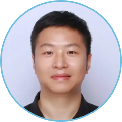
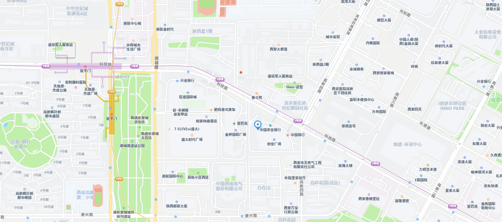
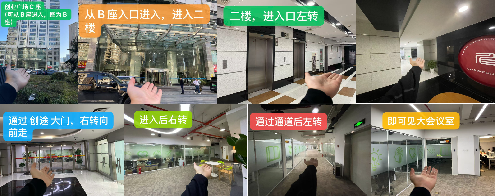
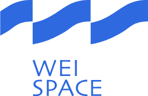

# DevFest 2026 西安站报名

GDG DevFest 是由 Google 开发者社区（GDG）在全球范围内主办的年度开发者盛会，内容覆盖 Android、Web、Cloud、AI 等多个技术方向。本次 DevFest 2026 西安站将带来一场关于企业私有化大模型部署的主题分享与一场基于 Gemini API 的期权分析 Codelab。

## 活动话题

### 大语言模型结合企业知识库的私有化部署：技术架构与实践

随着人工智能技术的快速发展，大语言模型（LLM）在企业中的应用日益广泛。然而，公有化部署的模型在数据安全性、合规性以及特定领域知识回答方面存在局限。私有化部署能够提供更高的数据安全性和合规性，同时允许企业根据自身需求定制化模型，提高模型的有效性和准确性。

本次分享将围绕私有化大模型部署展开，内容包括：

1. 为什么要用私有化大模型部署
   - 大语言模型在企业中的应用现状
   - 公有化与私有化部署的对比分析
   - 数据安全性与合规性
2. 基于 RAG 的企业知识库的构建思路
   - 技术架构
   - 大语言模型企业落地目前存在的问题及解决方案
3. 企业私有化大模型部署方案

> **分享嘉宾：黄鸿波**，AI领域创业者，深圳市鼎盛方圆科技CEO，谷歌AI方向开发者专家，《TensorFlow进阶指南》作者；历任金山西山居高级算法工程师、格力大数据中心AI专家，具备多年软件开发与技术管理经验。

### Codelab：使用 Gemini API 分析期权

运用最新的 Gemini API 模型，在 Colab 上分析期权，介绍完整的分析流程。参与者能够在 Colab 学会如何配置环境，使用 Gemini API，并且理解基本的期权分析方法。

**Codelab 链接（双语）：** [中文版](https://github.com/YuchengWang/OptionAnalyze/blob/main/option_analyze_using_gemini_3.8_flash_zh.ipynb) / [English](https://github.com/YuchengWang/OptionAnalyze/blob/main/option_analyze_using_gemini_3.8_flash_en.ipynb)

**注意事项：**

- 请务必携带电脑参加，否则无法参加 Codelab，最好准备好充电器，我们会提供插排
- 请务必使用个人 Gmail 账号参加，公司或学校管理的账号将无法使用
- 建议在 Chrome 浏览器中使用无痕模式，以避免账号冲突
- Codelab 需在 [Colab Enterprise](https://colab.google/) 环境下运行，请提前准备好运行环境
- 活动将提供 Google Cloud Platform 平台赠金用于使用付费服务，我们将在活动开始前告知相关信息
- 建议提前准备"国际网络环境"，避免现场人数太多 Wi‑Fi 速度变慢

> **Codelab 导师：王玉成**，拥有 15 年以上研发经验，技术涵盖操作系统、嵌入式、端侧 AI 与大模型应用。现专注于 Gemini 等大语言模型的工程化实践，推动技术在真实场景落地。

## 活动时间

2026年10月24日 周六 13:30 - 18:00

## 活动议程

| 时间 | 活动内容 |
|------|----------|
| 13:30 - 14:00 | 活动签到 |
| 14:00 - 15:10 | 大语言模型结合企业知识库的私有化部署：技术架构与实践 |
| 15:10 - 15:30 | 合影、茶歇 |
| 15:30 - 17:30 | Codelab：使用 Gemini API 分析期权 |
| 17:30 - 18:00 | 自由交流 |

## 活动地点

陕西省西安市雁塔区科技路48号创业广场c座2层 创途在XIAN
　　　　 [使用高德地图打开](https://surl.amap.com/cyhfPaxu22e)

**感谢 WEI SPACE人工智能孵化器提供免费场地**

## 报名方式

GDG 西安的活动均为免费活动，任何对开发感兴趣的朋友，都欢迎报名参加。

<https://www.wjx.top/vm/P70V7hc.aspx>

## 主办方

活动由GDG西安主办，GDG西安成立于2012年8月4日，是一个专注于 Google 开发技术、开源技术的技术社区。我们讨论的技术有 Android, Dart, Angular, Cloud Computing 等，开源技术一直是我们的最爱。

GDG西安是根植于西安的软件开发者社区，是 Google Developer Group Xi’an 的缩写，是谷歌开发者社区全球大家庭的一分子。我们每月会举行一次线下的开发者聚会，至2021年下半年，已举办100余次。

我们的活动主要形式是技术分享，由各位热心的社区成员，带给大家前沿的技术动向和深入的技术内容，也会不定期地举行 CodeLab 形式的活动，让大家在动手实践中学习和体会。

秉承着分享创新的精神，一切开源的技术：开源软件，开放技术标准等都是受欢迎的内容。一切技术从业者和爱好者都是我们欢迎的成员。如果你有意向分享知识与经验来展示自己，也可以报名成为我们的讲师，具体报名详情以及报名方法可以扫描下方二维码或者复制链接到浏览器打开

<https://jinshuju.net/f/EDndFr>

## 合作机构

WEI SPACE人工智能孵化器

